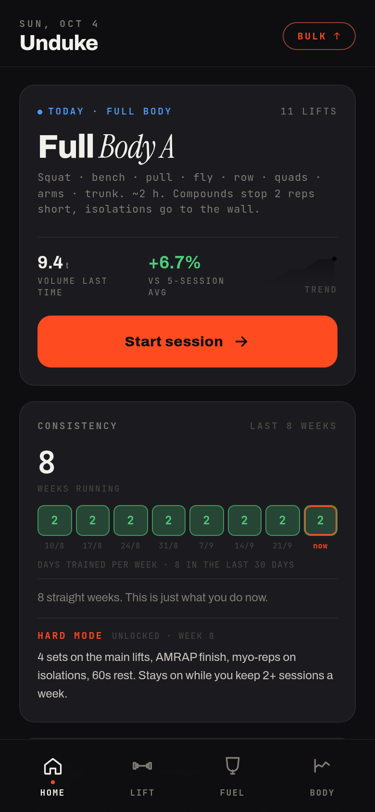
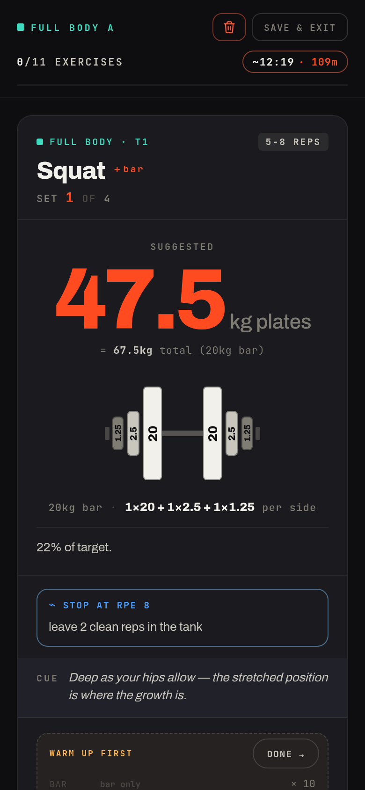
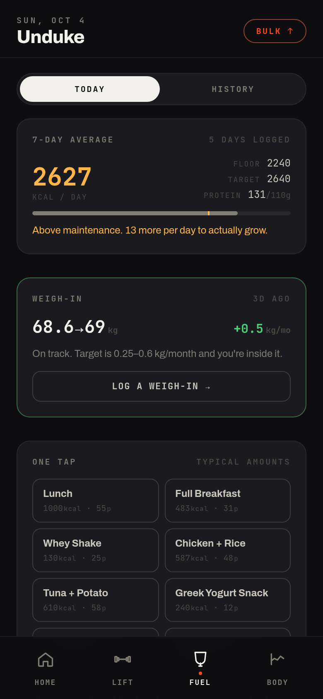
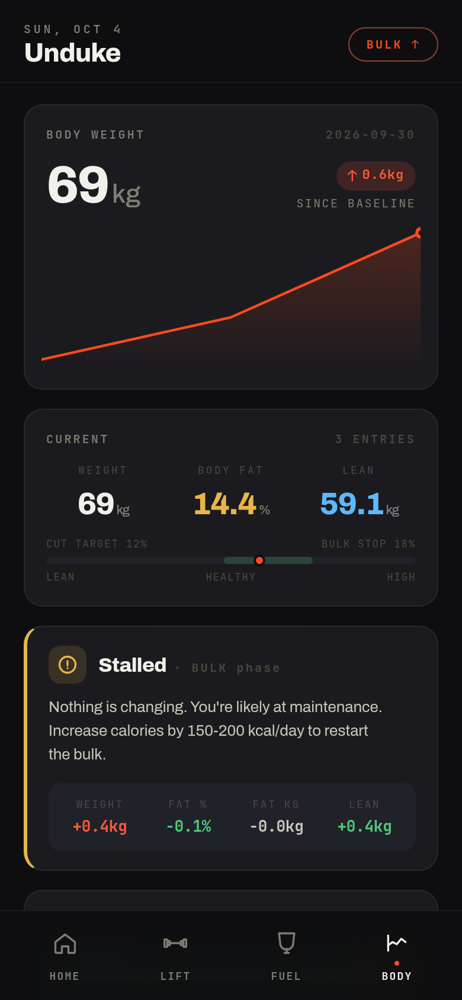

# Gym Tracker

An offline-first training, diet and body-composition tracker. One static page, no backend, no accounts, no runtime dependencies. All data lives in `localStorage` and moves between devices as a JSON backup.

The interesting part is the **auto-progression engine**: given a logged history of sets, weights and RPE, it decides what load to put on the bar next session.

> **Live:** https://gym-tracker-5sc.pages.dev (opens straight in a browser; on a phone, "Add to Home Screen" installs it as an offline app)

<p align="center">
  
  
  
  
</p>

<sub>Screenshots use invented demo data.</sub>

## What it does

- **Auto-progression from real logs.** A priority-ordered decision tree (crush / progress / fatigue-hold / deload / step-down / stall-reset / hold, first match wins) reads the last three sessions per exercise and returns the next weight with a plain-language reason.
- **Effort-aware.** Compounds are prescribed at RPE 8 (about 2 reps in reserve), isolations to failure. The tree rewards clean work at that effort instead of punishing anyone who doesn't grind every set to the top of the rep range.
- **Equipment-aware load snapping.** Barbell, machine and dumbbell increments differ. Barbell weights are plate weight, so warm-up ramps and deload floors convert to total load before applying percentages.
- **Real session flow.** Live set logging, rest timer that survives backgrounding, true superset alternation, tier-gated skipping, draft autosave with resume, and sessions that close themselves when abandoned.
- **Catch-up flow.** Exercises dropped from a session become pending makeups, derived on every render with no extra storage.
- **Diet and body-comp.** Calorie and protein targets from lean mass and actual training frequency, a rolling 7-day verdict, and a weight-trend signal that outranks the food log.
- **Optional push reminders.** A Cloudflare Worker implementing VAPID against WebCrypto, with no `web-push` dependency and payload-free pushes.

## Design decisions worth reading

- **Adherence is the product.** Consistency streaks instead of weekly quotas, calendar-week bucketing so numbers never move while you do nothing, and intensity phases that unlock only after consecutive weeks of showing up.
- **Destructive actions never look affirmative.** "End session early" is a two-tap confirm, not styled green, and is guarded by a regression test, because an earlier green one-tap version ended a real workout by accident.
- **Every invariant in the progression tree fixed a failure seen in real data.** Examples: measuring excess on the weakest set rather than the total, and treating RPE ≤ 8 with nothing failed as the protocol being followed, not as a stall.
- **Single file on purpose.** `index.html` runs with a double-click. A separate build step exists only to pre-transpile JSX.

## Run it

```sh
# no build needed: open index.html, or serve the directory
python3 -m http.server
```

## Tests

```sh
npm test      # syntax check -> 90+ logic assertions -> render every screen
```

`test/fixtures/sample-backup.json` is synthetic. Each entry reproduces a bug that was actually observed (AMRAP burnout sets, comma decimals, 0-rep sets, late-session fatigue). Dates are stored relative and hydrated at load, so the fixture never goes stale. The render suite also catches temporal-dead-zone bugs that Babel's `const`→`var` downlevelling hides in the browser.

## Production build

```sh
npm run build   # -> dist/
```

Pre-transpiles the JSX and drops the 2.8 MB Babel bundle from the runtime path. In-browser JSX transform costs about 1.7 s per launch on desktop (an estimated 5–9 s on a mid-range phone); the build removes it. Deploys as a static site, with build command `npm run build` and output directory `dist`.

## Stack

React 18, plain CSS, esbuild (build and tests only), service worker for offline, Cloudflare Pages and Workers.

## Docs

- [`SESSION_FORMAT.md`](SESSION_FORMAT.md): JSON schema for importing custom one-off sessions.
- [`CLAUDE.md`](CLAUDE.md): detailed architecture notes.

## License

MIT
